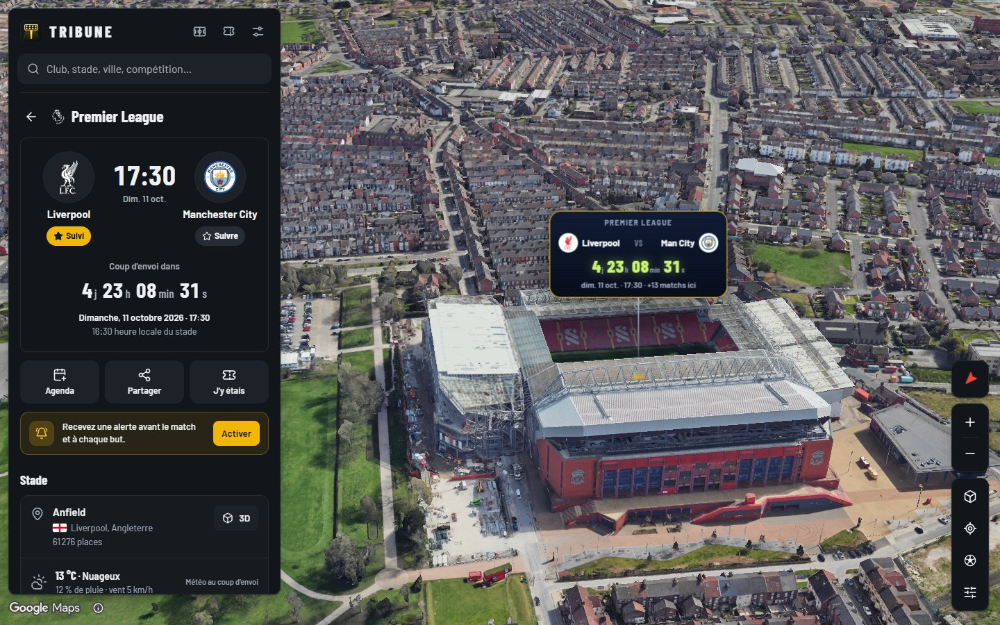
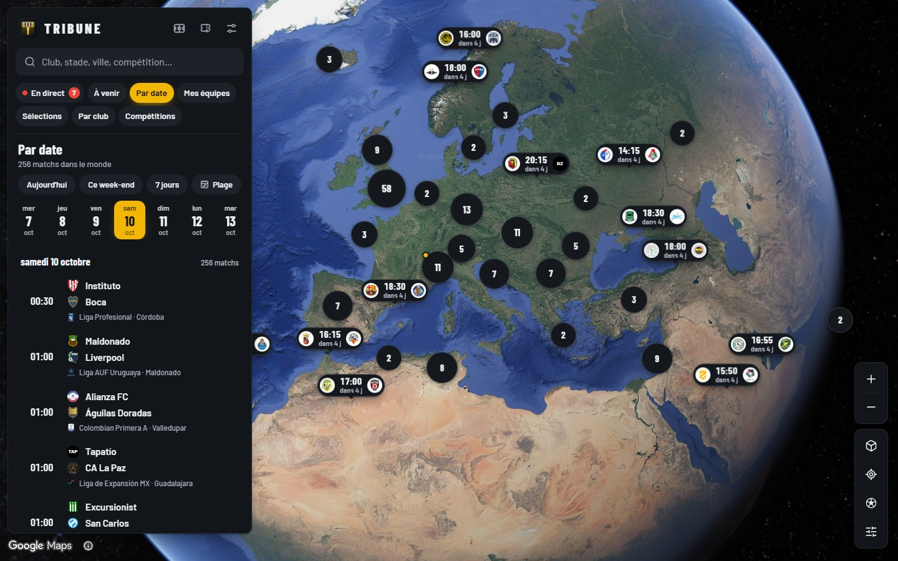
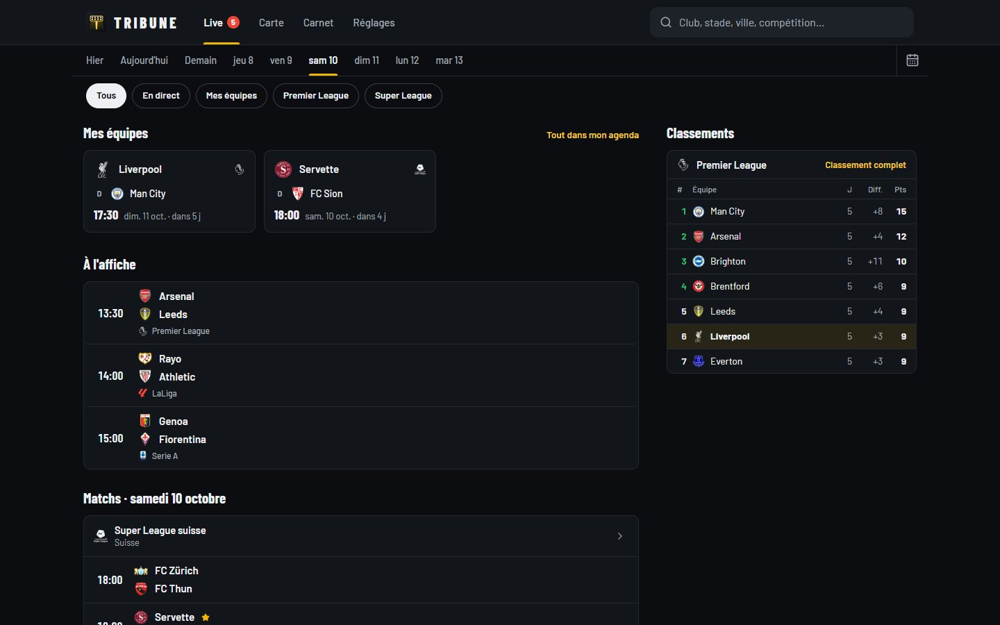
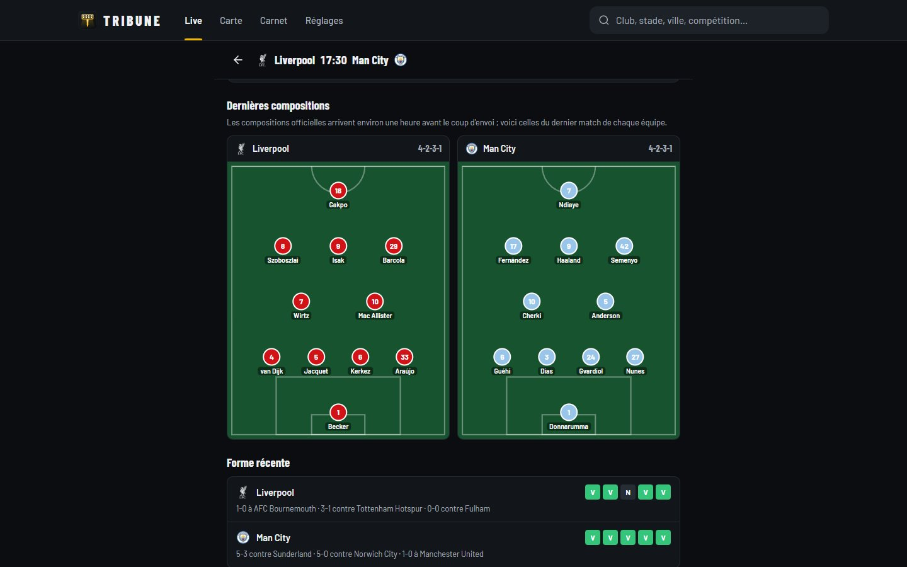
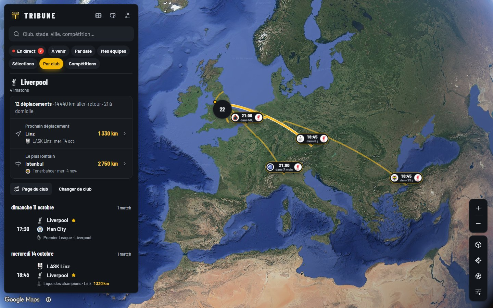
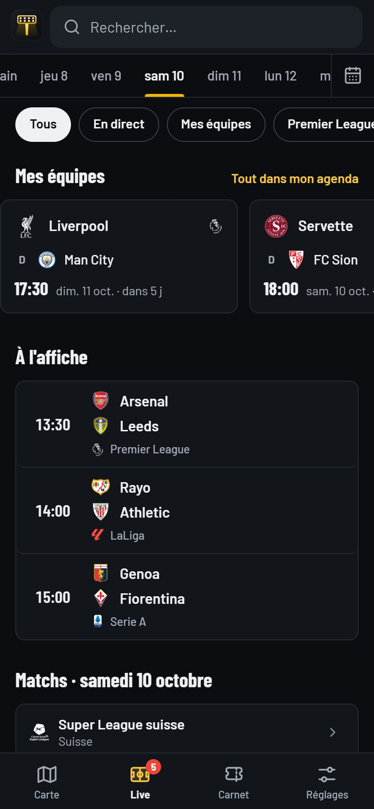
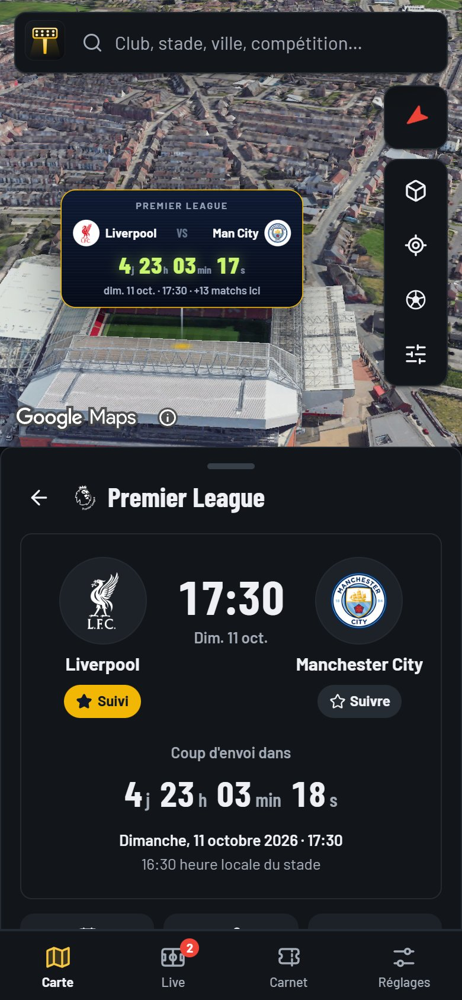
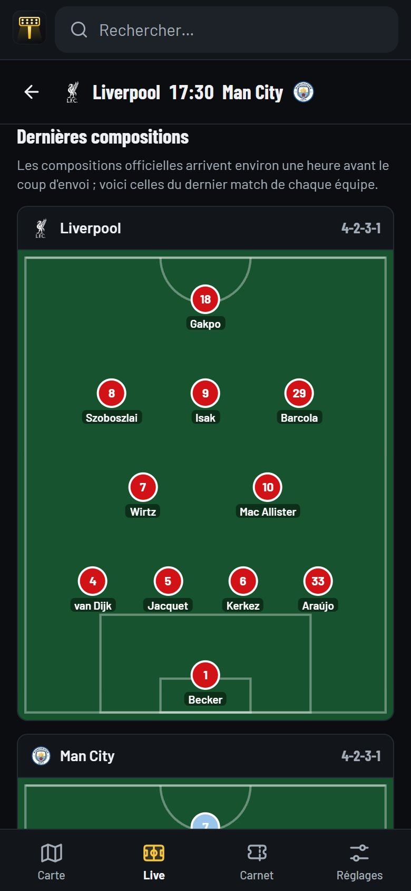

# TRIBUNE

Tous les matchs de football du monde sur une carte en 3D, et une page pour suivre le foot au quotidien.

On choisit une date et on voit où ça joue, d'un match de Coupe de Suisse à la Ligue des champions. On suit son club, on
regarde les buts tomber en direct sur la carte, et on garde la trace des stades où l'on est allé.

Le code source est privé. Cette page présente le projet. Les captures ont été prises le 6 octobre 2026 sur les
vraies données de l'app.

## Ce que fait l'app

### La carte des matchs

Chaque stade porte un marqueur avec les logos des deux équipes, l'heure et le délai avant le coup d'envoi
(« dans 4 j »), ou le score et la minute pendant le match. Les marqueurs se regroupent quand on dézoome. Sept façons
de filtrer : en direct, à venir, par date (jour, week-end, plage de dates), mes équipes, sélections, par club et par
compétition.

En zoomant sur un stade, on le voit en 3D réelle, avec son quartier. Un écran géant au-dessus de la pelouse affiche le compte à
rebours du prochain match et le nombre de matchs prévus à cet endroit.

### Le direct sur la carte

Les scores arrivent en direct sans recharger la page. Quand un but tombe, le marqueur du stade pulse et une bulle
indique la minute et le buteur. Avec « Suivre les buts », la caméra part d'elle-même vers le stade du dernier but.

### La page Live

L'écran d'ouverture, pour suivre le foot sans passer par la carte : les prochains matchs de mes équipes, les
affiches du jour, tous les matchs groupés par compétition, les classements et les dernières actualités. Les
actualités viennent de plusieurs médias français et d'ESPN, et une même info traitée par plusieurs journaux
n'apparaît qu'une fois. On change de jour d'un geste du doigt, on filtre par direct, par équipe ou par compétition,
et on tire vers le bas pour actualiser.

### La fiche de match

Compte à rebours, heure du coup d'envoi chez soi et au stade, météo prévue, forme récente des deux équipes,
derniers face-à-face et compositions dessinées sur un terrain. Avant l'annonce officielle, l'app montre la
dernière composition de chaque équipe. Depuis la fiche, on ajoute le match à son agenda, on le partage ou on
active une alerte.

### Les déplacements d'un club

Pour un club, la carte relie son stade à tous ses matchs à l'extérieur de la saison : nombre de déplacements,
kilomètres aller-retour, prochain voyage et le plus lointain. C'est la saison vue par un supporter qui suit son
équipe partout.

### Alertes, agenda et carnet

- **Alertes** : rappel la veille et une heure avant, compositions officielles, coup d'envoi, buts, mi-temps, fin et
  changement d'horaire, réglables équipe par équipe.
- **Agenda** : un abonnement par équipe, ou un seul pour toutes ses équipes, qui se met à jour tout seul.
- **Carnet** : les stades où l'on est allé, cochés après un match ou par championnat, sur une carte personnelle.
  Des défis (un championnat complet, les plus grands stades, le tour d'Europe, un derby…) donnent des badges, et
  la saison se partage en une image.
- **Stades mal placés** : chacun peut signaler un marqueur au mauvais endroit. Le serveur cherche lui-même la
  bonne position et la propose à la relecture.

### Sur téléphone

L'app s'installe sur l'écran d'accueil comme une app native. La carte est l'onglet en bas à gauche, à la manière
de la Snap Map, et les fiches s'ouvrent dans un tiroir. Sans réseau, elle affiche les dernières données reçues.

  
  
  

## Côté technique

- **Application** : React 19 et TypeScript, Vite, Tailwind CSS. Une seule base de code pour ordinateur, tablette
  et téléphone, installable (PWA) avec un service worker. Les écrans lourds se chargent à la demande : le code de l'écran
  d'ouverture pèse environ 110 Ko compressés.
- **Cartes** : Google Maps 3D (tuiles photoréalistes) avec marqueurs et arcs en 3D. Sans clé Google, l'app
  bascule sur un globe MapLibre GL et des tuiles OpenFreeMap, avec des stades en volumes simplifiés.
- **Serveur** : Node.js 24, qui exécute TypeScript sans compilation, Hono et SQLite (`node:sqlite`). Environ 130
  compétitions et plus de 10 000 matchs : synchronisation complète chaque nuit sur quatre mois, toutes les heures
  sur dix jours, toutes les 20 secondes quand un match est en cours. Le direct est poussé aux appareils par
  Server-Sent Events.
- **Stades** : près de 1 900 stades placés à partir de Wikidata et d'OpenStreetMap, puis recalés automatiquement
  sur la pelouse en lisant les terrains dans les tuiles vectorielles. Les cas ambigus (homonymes, villes fausses
  dans les sources) sont vérifiés sur photo aérienne.
- **Alertes** : notifications web (Web Push), sans compte. Le serveur ne connaît d'un appareil que son abonnement
  et ses équipes suivies.
- **Vie privée** : pas de compte. Les équipes suivies, le carnet et les défis restent sur l'appareil.
- **Partage** : chaque lien de match, d'équipe ou de compétition s'affiche avec un aperçu (titre, date, stade) dans
  les messageries. Agendas au format iCalendar.
- **Tests** : 86 tests automatisés (défis, lecture des flux, base et API, recalage des stades, détection des buts,
  déplacements).

## État du projet

Prototype complet qui tourne en local et se teste sur téléphone. Il n'est pas encore en ligne. Les données de
matchs viennent pour l'instant de flux gratuits (ESPN, TheSportsDB) ; une source sous licence prendra le relais
avant toute mise en ligne publique. Interface en français.

## Sources et crédits

- Carte 3D : Google Maps Platform, © Google.
- Fond de carte sans clé : [OpenFreeMap](https://openfreemap.org), données © les contributeurs
  [OpenStreetMap](https://www.openstreetmap.org/copyright).
- Position et capacité des stades : [Wikidata](https://www.wikidata.org) et Nominatim (OpenStreetMap).
- Météo : [Open-Meteo](https://open-meteo.com) (CC BY 4.0).
- Matchs, scores et compositions : ESPN et TheSportsDB.

Les noms et logos des clubs et des compétitions appartiennent à leurs propriétaires. Les actualités sont masquées
sur les captures, car leurs photos appartiennent aux journaux.

---

Projet d'Ali, [github.com/Ali213000](https://github.com/Ali213000). Code privé, tous droits réservés.
